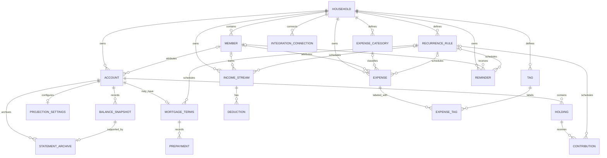

# Data Model

This document defines the first-pass persistence model for the household finance
dashboard. It expands the high-level model in the README into individual entities
and shows how they fit together. It is intended to guide the initial database
schema and shared API contracts; implementation details can be refined alongside
the feature work.

## Implementation status

The [backend schema](../backend/src/models/schema.ts) currently implements `Household`,
`Member`, `Account`, `BalanceSnapshot`, `ExpenseCategory`, and the one-off portion
of `Expense`, plus `StatementArchive`, using Drizzle ORM and one central SQLite database owned by the API.
These use UUID identifiers and two-place decimal-string amounts.
The API accepts manual accounts and snapshots, plus positive dated expenses
with optional household category/member attribution. Expense schedules,
`recurrenceRuleId`, tags, and all other entities below remain design definitions,
not implemented database tables. Expense entries do not alter account snapshots.
See the [backend guide](../backend/README.md) for setup and supported endpoints.

## Conventions

- The central SQLite database (capped at 1 GiB) is the source of truth. Store
  money as two-place decimal strings validated by constraints, never as
  floating-point types; aggregate in integer cents.
- Every table has a primary key and `createdAt` / `updatedAt` timestamps.
- Every household-owned record has a required `householdId`. Queries and
  relationships must be scoped to that household.
- `memberId` is optional on records that can be attributed to a household
  member. A member must belong to the same household as the record.
- Use soft deletion for records whose history affects financial reporting;
  deletion behavior for each entity is called out below.
- Store calendar dates as `YYYY-MM-DD` text and instants as UTC epoch
  milliseconds.
- IDs are opaque identifiers; their concrete representation is an implementation
  choice.

## Entities

### Household

The top-level owner and isolation boundary for financial data.

| Field                    | Type          | Constraints / notes         |
| ------------------------ | ------------- | --------------------------- |
| `id`                     | ID            | Primary key                 |
| `name`                   | String        | Required                    |
| `defaultCurrency`        | Currency code | Required; defaults to `CAD` |
| `createdAt`, `updatedAt` | Timestamp     | Required                    |

### Member

A person represented within a household. Authentication and household roles are
out of scope for v1.

| Field                    | Type      | Constraints / notes              |
| ------------------------ | --------- | -------------------------------- |
| `id`                     | ID        | Primary key                      |
| `householdId`            | ID        | Required; references `Household` |
| `name`                   | String    | Required                         |
| `createdAt`, `updatedAt` | Timestamp | Required                         |

### Account

A financial account, including deposit, investment, credit, loan, or mortgage
accounts. The account type describes the kind of account; its balance source
describes how its balance is obtained.

| Field                    | Type          | Constraints / notes                                               |
| ------------------------ | ------------- | ----------------------------------------------------------------- |
| `id`                     | ID            | Primary key                                                       |
| `householdId`            | ID            | Required; references `Household`                                  |
| `memberId`               | ID?           | Optional; references a member in the same household               |
| `name`                   | String        | Required                                                          |
| `type`                   | Enum          | `CHEQUING`, `SAVINGS`, `INVESTMENT`, `CREDIT`, `LOAN`, `MORTGAGE` |
| `currency`               | Currency code | Required                                                          |
| `balanceSource`          | Enum          | `MANUAL`, `PROJECTED`, `INTEGRATED`                               |
| `createdAt`, `updatedAt` | Timestamp     | Required                                                          |
| `deletedAt`              | Timestamp?    | Soft delete; preserve balance history                             |

### BalanceSnapshot

A dated account balance from a manual entry, integration sync, or projection.
Snapshots are immutable observations; corrections should be represented by a
corrected snapshot rather than overwriting historical values.

| Field                    | Type          | Constraints / notes                                   |
| ------------------------ | ------------- | ----------------------------------------------------- |
| `id`                     | ID            | Primary key                                           |
| `householdId`            | ID            | Required; references `Household`                      |
| `accountId`              | ID            | Required; references an account in the same household |
| `amount`                 | Decimal money | Required                                              |
| `asOf`                   | Timestamp     | Required; observation time                            |
| `source`                 | Enum          | `MANUAL`, `PROJECTED`, `INTEGRATED`                   |
| `createdAt`, `updatedAt` | Timestamp     | Required                                              |

### StatementArchive

The original document supporting an imported manual investment snapshot. Implemented
for supported Sun Life Canadian PDFs and Questrade XLSX exports; OCR is not supported.

| Field                                    | Type            | Constraints / notes                                                                                                       |
| ---------------------------------------- | --------------- | ------------------------------------------------------------------------------------------------------------------------- |
| `id`                                     | UUID            | Primary key                                                                                                               |
| `householdId`, `accountId`, `snapshotId` | UUID            | Composite FK to the same household/account snapshot; unique `snapshotId`                                                  |
| `filename`                               | String          | Original display filename, no path/control characters, max 200                                                            |
| `sha256`                                 | String          | SHA-256 of original bytes; unique per household/account                                                                   |
| `amount`                                 | Decimal money   | Parsed closing plan value                                                                                                 |
| `statementDate`                          | Date            | Closing period date; snapshot uses end-of-day UTC                                                                         |
| `currency`                               | Currency code   | CAD for this parser                                                                                                       |
| `byteLength`                             | Integer         | 1–10 MiB; equals stored byte length                                                                                       |
| `provider`                               | Enum            | `SUNLIFE` or `QUESTRADE`; existing rows default to `SUNLIFE`                                                              |
| `pdf`                                    | Binary (`BLOB`) | Original PDF or XLSX bytes; never included in metadata responses                                                          |
| `questrade`                              | JSON?           | Export account type, FX, native cash and combined cash; null for Sun Life                                                 |
| `investments`                            | JSON?           | Historical rows: name, nullable category, decimal-string units, unitPrice, value; null for absent section/legacy archives |
| `createdAt`, `updatedAt`                 | Timestamp       | Required                                                                                                                  |

Snapshot and document archive are committed in one transaction. Preview does not persist
either record. Original documents and snapshot metadata cannot be edited or deleted
through the API; derived investment details can be re-extracted from the archived
document without creating another snapshot. Account soft deletion preserves the original.
Files are stored as BLOBs in the central SQLite file and its backups. Historical investment
rows are not the planned editable `Holding` entity and do not add to net worth.

`StatementArchive` also supports Questrade InvestmentSummary XLSX imports.
`provider` identifies `SUNLIFE` (default for existing archives) or `QUESTRADE`.
Nullable `questrade` JSON stores account type, export FX rate, native CAD/USD
cash and CAD-combined cash as decimal strings. Investment rows optionally include
symbol and native currency. The existing binary `pdf` column stores original
bytes for both formats; metadata never includes file bytes. Questrade's undated
export requires a user-supplied observation date, and its snapshot uses exported
CAD-combined equity including cash. See the [backend import guide](../backend/README.md#questrade-xlsx-imports).

### ProjectionSettings

Optional settings for projecting an account balance. The projection engine and
rate conventions belong to the domain package, not the persistence model.

| Field                    | Type          | Constraints / notes                                           |
| ------------------------ | ------------- | ------------------------------------------------------------- |
| `id`                     | ID            | Primary key                                                   |
| `householdId`            | ID            | Required; references `Household`                              |
| `accountId`              | ID            | Required; unique; references an account in the same household |
| `initialAmount`          | Decimal money | Required                                                      |
| `annualReturnRate`       | Decimal rate  | Required; stored as a rate, not money                         |
| `createdAt`, `updatedAt` | Timestamp     | Required                                                      |

### Holding

An investment position within an investment account. A holding identifies what
is being projected and provides the basis for its contributions.

| Field                    | Type          | Constraints / notes                                   |
| ------------------------ | ------------- | ----------------------------------------------------- |
| `id`                     | ID            | Primary key                                           |
| `householdId`            | ID            | Required; references `Household`                      |
| `accountId`              | ID            | Required; references an account in the same household |
| `name`                   | String        | Required                                              |
| `initialAmount`          | Decimal money | Required                                              |
| `annualReturnRate`       | Decimal rate  | Required                                              |
| `createdAt`, `updatedAt` | Timestamp     | Required                                              |
| `deletedAt`              | Timestamp?    | Soft delete when preserving history                   |

### Contribution

A planned contribution to a holding. A contribution can be recurring or
one-off; recurring contributions reference a recurrence rule.

| Field                    | Type          | Constraints / notes                                  |
| ------------------------ | ------------- | ---------------------------------------------------- |
| `id`                     | ID            | Primary key                                          |
| `householdId`            | ID            | Required; references `Household`                     |
| `holdingId`              | ID            | Required; references a holding in the same household |
| `amount`                 | Decimal money | Required                                             |
| `startDate`              | Date          | Required                                             |
| `endDate`                | Date?         | Optional; must not precede `startDate`               |
| `recurrenceRuleId`       | ID?           | References a recurrence rule; null for one-off       |
| `createdAt`, `updatedAt` | Timestamp     | Required                                             |

### MortgageTerms

Mortgage-specific terms for a mortgage account. The mortgage payment schedule
is represented by a recurrence rule, while payment amounts and amortization
calculations are derived by the domain logic.

| Field                    | Type           | Constraints / notes                                                   |
| ------------------------ | -------------- | --------------------------------------------------------------------- |
| `id`                     | ID             | Primary key                                                           |
| `householdId`            | ID             | Required; references `Household`                                      |
| `accountId`              | ID             | Required; unique; references a mortgage account in the same household |
| `principal`              | Decimal money  | Required                                                              |
| `annualInterestRate`     | Decimal rate   | Required                                                              |
| `rateType`               | Enum           | `FIXED`, `VARIABLE`                                                   |
| `compoundingFrequency`   | Enum / integer | Required; defaults to semi-annual                                     |
| `amortizationMonths`     | Integer        | Required; greater than zero                                           |
| `termMonths`             | Integer        | Required; greater than zero                                           |
| `paymentFrequency`       | Enum           | `MONTHLY`, `BIWEEKLY`, `ACCELERATED_BIWEEKLY`, `WEEKLY`               |
| `startDate`              | Date           | Required                                                              |
| `recurrenceRuleId`       | ID?            | References the mortgage payment recurrence rule                       |
| `createdAt`, `updatedAt` | Timestamp      | Required                                                              |

### Prepayment

An additional payment against mortgage principal.

| Field                    | Type          | Constraints / notes                                       |
| ------------------------ | ------------- | --------------------------------------------------------- |
| `id`                     | ID            | Primary key                                               |
| `householdId`            | ID            | Required; references `Household`                          |
| `mortgageTermsId`        | ID            | Required; references mortgage terms in the same household |
| `amount`                 | Decimal money | Required; greater than zero                               |
| `date`                   | Date          | Required                                                  |
| `createdAt`, `updatedAt` | Timestamp     | Required                                                  |

### IncomeStream

An income source for the household, optionally attributed to a member. Pay
occurrences are generated from its recurrence rule; gross and deduction amounts
are inputs to the net-pay calculation.

| Field                    | Type          | Constraints / notes                                     |
| ------------------------ | ------------- | ------------------------------------------------------- |
| `id`                     | ID            | Primary key                                             |
| `householdId`            | ID            | Required; references `Household`                        |
| `memberId`               | ID?           | Optional; references a member in the same household     |
| `name`                   | String        | Required                                                |
| `type`                   | Enum          | `SALARY`, `SIDE_INCOME`, `BENEFIT`, `OTHER`             |
| `grossAmount`            | Decimal money | Required                                                |
| `currency`               | Currency code | Required                                                |
| `recurrenceRuleId`       | ID?           | References a recurrence rule; null for a one-off income |
| `createdAt`, `updatedAt` | Timestamp     | Required                                                |
| `deletedAt`              | Timestamp?    | Soft delete where history is needed                     |

### Deduction

A deduction applied to an income stream, such as tax, CPP, EI, pension,
benefits, or an RRSP match. The amount is the per-occurrence deduction.

| Field                    | Type          | Constraints / notes                                         |
| ------------------------ | ------------- | ----------------------------------------------------------- |
| `id`                     | ID            | Primary key                                                 |
| `householdId`            | ID            | Required; references `Household`                            |
| `incomeStreamId`         | ID            | Required; references an income stream in the same household |
| `name`                   | String        | Required                                                    |
| `amount`                 | Decimal money | Required; non-negative                                      |
| `createdAt`, `updatedAt` | Timestamp     | Required                                                    |

### Expense

A recurring or one-off expense. Only one-off expenses are implemented; recurrence
rules and generated occurrences are planned. The API lists active expenses for
a calendar month and returns exact totals per currency across all matching rows,
independent of pagination. Archived rows are retained but excluded from these totals.

| Field                    | Type          | Constraints / notes                                            |
| ------------------------ | ------------- | -------------------------------------------------------------- |
| `id`                     | ID            | Primary key                                                    |
| `householdId`            | ID            | Required; references `Household`                               |
| `memberId`               | ID?           | Optional; references a member in the same household            |
| `categoryId`             | ID?           | Optional; references an expense category in the same household |
| `name`                   | String        | Required                                                       |
| `amount`                 | Decimal money | Required; greater than zero                                    |
| `currency`               | Currency code | Required                                                       |
| `startDate`              | Date          | Required; API supports years 1000–9999                         |
| `recurrenceRuleId`       | ID?           | References a recurrence rule; null for one-off                 |
| `createdAt`, `updatedAt` | Timestamp     | Required                                                       |
| `deletedAt`              | Timestamp?    | Soft delete where history is needed                            |

### ExpenseCategory

A household-defined category used to group expenses in reports.

Category creation and listing are implemented. Names are trimmed and unique
within a household (case-sensitive). Category rename/delete and reports by
category are not implemented yet.

| Field                    | Type      | Constraints / notes                   |
| ------------------------ | --------- | ------------------------------------- |
| `id`                     | ID        | Primary key                           |
| `householdId`            | ID        | Required; references `Household`      |
| `name`                   | String    | Required; unique within the household |
| `createdAt`, `updatedAt` | Timestamp | Required                              |

### Tag and ExpenseTag

Tags provide optional, many-to-many labels for expenses. `Tag` is unique by
name within a household; `ExpenseTag` is the join entity.

| Entity       | Fields                                                        | Constraints / notes                                                                      |
| ------------ | ------------------------------------------------------------- | ---------------------------------------------------------------------------------------- |
| `Tag`        | `id`, `householdId`, `name`, `createdAt`, `updatedAt`         | `name` unique within household                                                           |
| `ExpenseTag` | `householdId`, `expenseId`, `tagId`, `createdAt`, `updatedAt` | Composite primary key `(expenseId, tagId)`; both references must belong to the household |

### RecurrenceRule

A normalized schedule definition used by recurring income, expenses,
contributions, and mortgage payments. This stores rule parameters only; the
shared domain recurrence engine interprets them and generates occurrences.

| Field                    | Type           | Constraints / notes                                       |
| ------------------------ | -------------- | --------------------------------------------------------- |
| `id`                     | ID             | Primary key                                               |
| `householdId`            | ID             | Required; references `Household`                          |
| `frequency`              | Enum           | `WEEKLY`, `BIWEEKLY`, `SEMI_MONTHLY`, `MONTHLY`, `CUSTOM` |
| `interval`               | Integer        | Required; greater than zero                               |
| `startDate`              | Date           | Required                                                  |
| `endDate`                | Date?          | Optional; must not precede `startDate`                    |
| `weekdays`               | Integer array? | Optional; for applicable weekly/custom rules              |
| `monthDays`              | Integer array? | Optional; for applicable monthly rules                    |
| `createdAt`, `updatedAt` | Timestamp      | Required                                                  |

### Reminder

A custom calendar reminder, such as a mortgage renewal or RRSP deadline.
Reminders may optionally recur through the shared recurrence engine.

| Field                    | Type      | Constraints / notes                                 |
| ------------------------ | --------- | --------------------------------------------------- |
| `id`                     | ID        | Primary key                                         |
| `householdId`            | ID        | Required; references `Household`                    |
| `memberId`               | ID?       | Optional; references a member in the same household |
| `title`                  | String    | Required                                            |
| `date`                   | Date      | Required                                            |
| `recurrenceRuleId`       | ID?       | Optional; references a recurrence rule              |
| `createdAt`, `updatedAt` | Timestamp | Required                                            |

### IntegrationConnection (future)

A connection to a bank or brokerage provider. This is reserved for the
integration phase; credentials and access tokens must be encrypted at rest and
must never be returned to the client.

| Field                    | Type           | Constraints / notes                         |
| ------------------------ | -------------- | ------------------------------------------- |
| `id`                     | ID             | Primary key                                 |
| `householdId`            | ID             | Required; references `Household`            |
| `provider`               | String         | Required                                    |
| `status`                 | Enum           | `ACTIVE`, `DISCONNECTED`, `ERROR`           |
| `encryptedCredentials`   | Encrypted data | Server-only; never exposed in API responses |
| `createdAt`, `updatedAt` | Timestamp      | Required                                    |

## Entity Relationship Diagram

`HOUSEHOLD` is the required scope for all owned records; it is omitted from some
diagram edges above where the direct entity relationship already implies
household ownership. Foreign keys should enforce that both sides of every
relationship belong to the same household.

## Integrity Rules

- Account-specific settings and mortgage terms are one-to-zero-or-one. A
  `MORTGAGE_TERMS` row may reference only an account with type `MORTGAGE`.
- Holdings may reference only `INVESTMENT` accounts.
- A recurrence rule may be referenced by multiple items only if they are
  intentionally sharing the same schedule. Otherwise create a separate rule
  row; recurrence execution is shared, but schedules are per item by default.
- Validate all money values in the API and domain layer; database constraints
  should also reject invalid negative values where the domain does not allow
  them.
- Enforce household consistency for foreign keys (for example with composite
  unique keys and composite foreign keys, or equivalent database constraints).
- Generated calendar occurrences are derived data and are not persisted in
  this model. Persist only source records and recurrence rules.

## Scope Notes

- `IntegrationConnection` is shown to preserve the planned extension point, but
  its provider-specific schema belongs to the integration phase.
- Transactions are not modeled in this first pass. CSV import can be added
  without treating imported transactions as a new ledger until that workflow is
  designed.
- Authentication and household membership roles are deferred; `Member` is a
  finance attribution entity for v1, not an authenticated user.
